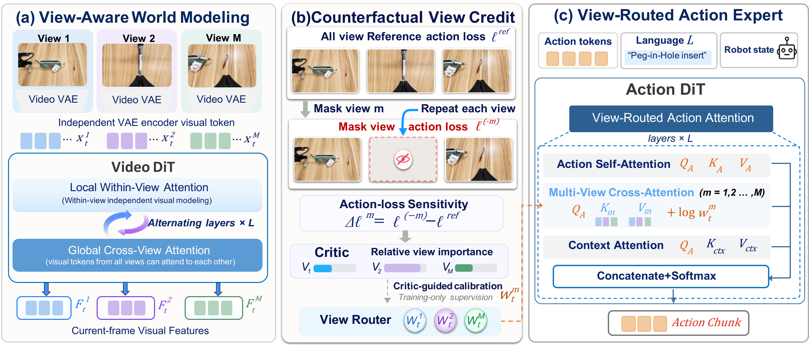

<div align="center">
  <h1>FlexWAM: Learning Flexible Visual Routing for World Action Models</h1>

  <p>
    <a href="https://github.com/zming-Mei">Mingyu Mei</a><sup>1,*</sup>,
    <a href="https://github.com/xuhaojie026">Haojie Xu</a><sup>1,*</sup>,
    <a href="https://github.com/SelfGala">Zibo Dai</a><sup>1</sup>,
    <a href="https://tonyfang.net/">Hongjie Fang</a><sup>2</sup>,
    <a href="https://www.linkedin.com/in/shiruntang/">Shirun Tang</a><sup>3</sup>,
    <a href="mailto:3240103193@zju.edu.cn">Zhengrui Lv</a><sup>1</sup>,
    <a href="https://lamb97.github.io/">Yang Liu</a><sup>4</sup>,
    <a href="mailto:icomputing@126.com">Guang Chen</a><sup>1,5</sup>,
    <a href="mailto:zhaoxinyue@zju.edu.cn">Xingyue Zhao</a><sup>1</sup>,
    <a href="https://person.zju.edu.cn/en/shenhl">Huiliang Shen</a><sup>1</sup>,
    <a href="https://person.zju.edu.cn/en/zaixinghe">Zaixing He</a><sup>1,†</sup>
  </p>

  <p>
    <sup>1</sup>Zhejiang University &ensp;
    <sup>2</sup>Shanghai Jiao Tong University &ensp;
    <sup>3</sup>Noematrix &ensp;
    <sup>4</sup>University of Minnesota &ensp;
    <sup>5</sup>EndlessAI
  </p>

  <p><sup>*</sup>Equal contribution. &emsp; <sup>†</sup>Corresponding author.</p>

  <p>
    <a href="#citation">
      
    </a>
    <a href="https://flexwam.github.io/">
      
    </a>
  </p>
</div>

FlexWAM learns flexible visual routing for world action models. Alternating within-view and cross-view attention captures view-specific dynamics and complementary cues. An observation-conditioned view router, calibrated by a critic trained on counterfactual view credit, prioritizes the cameras most relevant to the current action.

<p align="center">
  
</p>


## 📁 1. Repository Structure

```text
FlexWAM/
├── configs/              # data, model, and task YAML
├── src/flexwam/          # model, data, training, inference
├── deploy/               # WebSocket server and robot profiles
├── scripts/
│   ├── train/            # ZeRO launchers
│   ├── preprocess/       # text caches and ActionDiT backbone prep
│   └── evaluation/       # open-loop and visualization entry points
└── tests/                # unittest modules named test_*.py
```

---

## ⚙️ 2. Environment Setup

### 2.1 Install

Create a Python 3.10 environment, then install a CUDA PyTorch wheel before the project dependencies. `deepspeed` compiles during install, so `gcc` must be on `PATH`.

```bash
conda create -n flexwam python=3.10 -y
conda activate flexwam
pip install -U pip
pip install torch==2.7.1+cu128 torchvision==0.22.1+cu128 --extra-index-url https://download.pytorch.org/whl/cu128
pip install -e .
```

Run commands from the repository root. Configs and scripts are read from the checkout.

### 2.2 Weights

Save checkpoints under `./checkpoints`. Commands below use `hf download`; `modelscope download` takes the same arguments, with LingBot id `Robbyant/lingbot-video-dense-1.3b`. WAN files are read from `$FLEXWAM_MODEL_BASE_PATH/<repo id>/`. The default source is ModelScope. Set `DIFFSYNTH_DOWNLOAD_SOURCE=huggingface` to use Hugging Face. Text precompute downloads only when `FLEXWAM_SKIP_DOWNLOAD=false`.

LingBot Video. The public tokenizer directory is `processor/`; the loader reads `tokenizer/`.

```bash
hf download robbyant/lingbot-video-dense-1.3b --local-dir ./checkpoints/lingbot-video
ln -sfn processor ./checkpoints/lingbot-video/tokenizer
python scripts/preprocess/preprocess_lingbot_action_dit_backbone.py \
  --model-config configs/model/lingbot_video.yaml \
  --lingbot-model-path ./checkpoints/lingbot-video \
  --output ./checkpoints/lingbot-video/LingBotActionDiT_backbone_2048hdim.pt
export FLEXWAM_LINGBOT_PATH="$PWD/checkpoints/lingbot-video"
export FLEXWAM_ACTION_DIT_PATH="$FLEXWAM_LINGBOT_PATH/LingBotActionDiT_backbone_2048hdim.pt"
```

WAN. Wan2.1 supplies the UMT5 tokenizer (`google/umt5-xxl`). Wan2.2 supplies the video DiT. A missing T5 encoder or VAE is fetched on first load.

```bash
export FLEXWAM_MODEL_BASE_PATH="$PWD/checkpoints"
export DIFFSYNTH_MODEL_BASE_PATH="$FLEXWAM_MODEL_BASE_PATH"
hf download Wan-AI/Wan2.1-T2V-1.3B --include "google/umt5-xxl/*" \
  --local-dir ./checkpoints/Wan-AI/Wan2.1-T2V-1.3B
hf download Wan-AI/Wan2.2-TI2V-5B --include "diffusion_pytorch_model*.safetensors" \
  --local-dir ./checkpoints/Wan-AI/Wan2.2-TI2V-5B
python scripts/preprocess/preprocess_wan_action_dit_backbone.py \
  --model-config configs/model/wan22.yaml \
  --output ./checkpoints/ActionDiT_linear_interp_Wan22_alphascale_1024hdim.pt
export FLEXWAM_ACTION_DIT_PATH="$PWD/checkpoints/ActionDiT_linear_interp_Wan22_alphascale_1024hdim.pt"
```

---

## 🧩 3. Configuration

Hydra configs are split into three groups:

| Group | Path | Role |
|---|---|---|
| `data` | `configs/data/` | Robot dimensions, cameras, action representation, dataset roots |
| `model` | `configs/model/` | `wan22` or `lingbot_video` |
| `task` | `configs/task/` | One training job: which data and model, plus hyperparameters |

Data configs are the two robot contracts. A task selects one and sets `data.roots`. Replace `/path/to/...` in the task file, or override `data.roots` on the command line. Inspect the resolved config before training:

```bash
python scripts/train.py task=wan/piper_pencil_case --cfg job --resolve
```

| Data | Action | Cameras |
|---|---|---|
| `piper` | 14D dual-arm joint delta; grippers stay absolute | global, left wrist, right wrist |
| `flexiv` | 10D pose6D delta | global, side, wrist |

To add a task config, copy one of the examples below. The same five tasks exist under `configs/task/wan/` and `configs/task/lingbot/`.

| Task | Data |
|---|---|
| `piper_pencil_case` | Pencil Case Packing |
| `piper_conveyor` | Conveyor Sorting |
| `flexiv_cable` | Cable Insertion |
| `flexiv_peg_round` | Round peg-in-hole |
| `flexiv_peg_l_shape` | L-shape peg-in-hole |

---

## 🚀 4. Training

`scripts/train/train_wan.sh` precomputes UMT5 embeddings, then launches ZeRO-1 on eight GPUs. Set `DATASET_DIR` to the LeRobot root and `FLEXWAM_MODEL_BASE_PATH` to the WAN weight directory from [Weights](#22-weights). The default task is `wan/flexiv_cable`. Extra Hydra overrides are forwarded to both the precompute and the trainer. Checkpoints go to `FLEXWAM_OUTPUT_BASE_DIR` (default `./runs`). `wandb.enabled` defaults to false.

```bash
export DATASET_DIR=/path/to/flexiv_cable
export FLEXWAM_MODEL_BASE_PATH=/path/to/wan22
bash scripts/train/train_wan.sh
```

`scripts/train/train.sh` is the ZeRO-1 launcher; its first argument is the process count. `scripts/train/train_zero2.sh` selects ZeRO-2.

`scripts/train/train_lingbot.sh` is the LingBot counterpart. It precomputes Qwen embeddings with `scripts/preprocess/precompute_lingbot_text_embeds.py`. `TASK` is any `lingbot/` task. `FLEXWAM_LINGBOT_PATH` is the LingBot checkout, and `FLEXWAM_ACTION_DIT_PATH` defaults to `LingBotActionDiT_backbone_2048hdim.pt` inside that checkout.

```bash
export DATASET_DIR=/path/to/flexiv_peg_l_shape
export FLEXWAM_LINGBOT_PATH=/path/to/lingbot-video
bash scripts/train/train_lingbot.sh

TASK=lingbot/piper_conveyor DATASET_DIR=/path/to/piper_conveyor \
  bash scripts/train/train_lingbot.sh
```

---

## 🤖 5. Deploy and Evaluate

### 5.1 Deploy

`deploy/deploy_piper.sh` serves a WAN checkpoint over WebSocket. The server has no authentication. The script binds `0.0.0.0`; change `--host` to `127.0.0.1` unless the port should be reachable on a lab network.

Set `RUN_DIR` to the training run. The script reads `checkpoints/weights/step.pt` and `dataset_stats.json` under that directory unless `CHECKPOINT_PATH` and `DATASET_STATS_PATH` are set. `FLEXWAM_MODEL_BASE_PATH` is the frozen WAN VAE, UMT5 encoder, and tokenizer directory. `--task` in the script is `wan/piper_pencil_case`; change it and `--robot-type` together. `--robot-type` is `piper` or `flexiv`. `--delta` must match the checkpoint.

```bash
export RUN_DIR=/path/to/run
export FLEXWAM_MODEL_BASE_PATH=/path/to/wan22
export CUDA_VISIBLE_DEVICES=0
bash deploy/deploy_piper.sh
```

`deploy/deploy_flexiv.sh` is the LingBot template. It reads `FLEXWAM_LINGBOT_PATH` instead of the WAN base directory.

### 5.2 Evaluate

See `scripts/evaluation/`. `open_loop.py` compares predicted actions with dataset ground truth. `open_loop_deploy.py` runs the deployment policy and writes the action plots. `visualize_critic.py` and `visualize_router.py` render the critic and router videos. Each script prints its arguments with `--help`.

---

## 🙏 Acknowledgement

FlexWAM uses code and designs from the projects below.

- [OpenPI](https://github.com/Physical-Intelligence/openpi). `deploy/client/` is the OpenPI WebSocket policy protocol used by the deployment server.
- [FastWAM](https://github.com/yuantianyuan01/FastWAM). The WAN2.2 path — Hydra task configs, ActionDiT backbone preprocessing, text-embedding caches, and open-loop evaluation — follows FastWAM.
- [LingBot-Video](https://github.com/Robbyant/lingbot-video). The LingBot video expert lives in `src/flexwam/models/backbone/lingbot_video/` and loads LingBot-Video weights.
- [OpenWAM](https://github.com/OpenWAM-Official/OpenWAM). Image transforms and color jitter follow OpenWAM.

---

## 📄 License

FlexWAM is released under the [Apache License 2.0](LICENSE). Copyright 2026 The FlexWAM Authors. Files that still carry an upstream copyright header keep that header.

---

## 📚 Citation

arXiv: coming soon.

<!-- Replace the eprint and url when the arXiv id is available. -->

```bibtex
@misc{mei2026flexwam,
  title={FlexWAM: Learning Flexible Visual Routing for World Action Models},
  author={Mingyu Mei and Haojie Xu and Zibo Dai and Hongjie Fang and Shirun Tang and Zhengrui Lv and Yang Liu and Guang Chen and Xingyue Zhao and Huiliang Shen and Zaixing He},
  year={2026},
  eprint={XXXX.XXXXX},
  archivePrefix={arXiv},
  primaryClass={cs.RO},
  url={https://arxiv.org/abs/XXXX.XXXXX},
}
```
